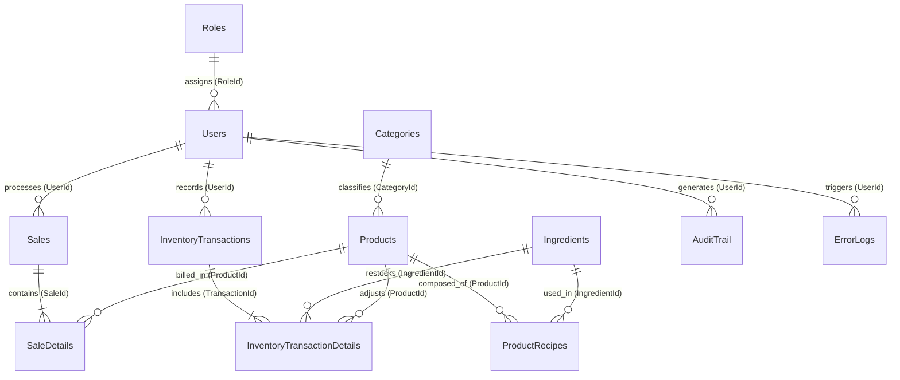
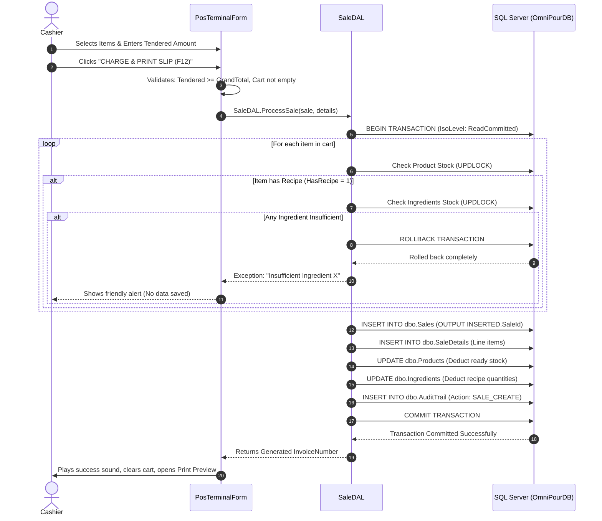

# OMNIPOUR POS & Beverage Inventory Processing System
**Comprehensive Final Project Technical Report & Defense Documentation**  
*C# Windows Forms (.NET 8.0) • Microsoft SQL Server (SSMS / ADO.NET)*

---

## 1. Project Information & Team Organization

### 1.1 Academic Project Metadata
* **Course / Subject**: Application Development & Database Management Systems
* **Project Title**: OMNIPOUR: Enterprise Beverage Transaction Processing & Recipe Inventory Management Suite
* **System Type**: Desktop Point-of-Sale (POS) & Enterprise Resource Planning (ERP) Transaction Processing System
* **Implementation Stack**: C# Windows Forms (.NET 8.0), Microsoft SQL Server 2019/2022 / LocalDB, ADO.NET (`Microsoft.Data.SqlClient`)
* **Design Aesthetic**: Executive Obsidian Dark (`#0F172A`) & Warm Amber Gold (`#F59E0B`)

### 1.2 Module Ownership & Team Responsibilities
Per Section II.4 of the Final Project Guidelines, module ownership is delineated below to ensure individual accountability during the defense:

| Team Member | Assigned Modules & System Scope | Key Deliverables & Responsibilities |
| :--- | :--- | :--- |
| **Lead Developer / Member 1** | **Security, Authentication & Administration** | • PBKDF2-HMAC-SHA256 password hashing & 128-bit salting<br>• Automated 3-strike account lockout logic & session state<br>• User Management Module (CRUD, soft delete, password reset)<br>• Role-Based Access Control (RBAC) enforcement<br>• Database Backup & Restore module (`DatabaseMaintenanceDAL`) |
| **Systems Developer / Member 2** | **Transaction Processing & POS Terminal** | • POS Cashier Counter & interactive beverage catalog<br>• Atomic multi-table checkout engine (`SaleDAL` with `SqlTransaction`)<br>• Automatic raw recipe ingredient deduction & rollback checks<br>• Sales History audit viewer & supervisor voiding engine<br>• Printable thermal-style receipt generation (`PrintDocument`) |
| **Database & Analytics / Member 3**| **Master Data, Inventory & Business Intelligence**| • 3NF Normalized Database Schema & Constraints (`OmniPourDB`)<br>• Stock Receiving & Restock Module (Transaction Module 2)<br>• Product, Category & Raw Ingredient Master Modules<br>• Concurrency handling with `rowversion` timestamps<br>• Analytic Reports (Daily Sales, Product Sales, Low Stock) & CSV Export |

---

## 2. Business Context & Real-World Client Profile

### 2.1 Client Profile & Field Research
* **Client Partner**: *OMNIPOUR Specialty Coffee & Artisan Tea Bar* (Manila Flagship Branch)
* **Stakeholder Interviewed**: Store General Manager & Lead Barista
* **Operational Profile**: Independent quick-service beverage craft shop serving 180–320 customized hot/iced espresso drinks, cold brews, and milk teas per day.

### 2.2 Problem Statement
Prior to the implementation of OMNIPOUR, the client operated on a disjointed workflow relying on paper receipts and a manual spreadsheet:
1. **Mid-Shift Stockouts Due to Unlogged Recipe Usage**: Beverages consume small fractional amounts of raw ingredients (e.g., 18g espresso beans, 220ml whole milk, 30ml vanilla syrup per cup). Staff could not manually log these fractions during peak rush hours, causing sudden ingredient depletion and customer turnaways.
2. **Disconnected POS and Stock Ledgers**: The cashier counter had no real-time link to the stockroom. If a drink was sold out of stock, cashiers still rang it up, resulting in customer friction and awkward refunds.
3. **No Defensible Audit Trail**: Transaction voids and stock adjustments were scribbled on clipboards, leaving store ownership vulnerable to pilferage, unauthorized voids, and unrecorded cash discrepancies.
4. **Shared Generic Accounts & Overwrite Collisions**: Multiple staff used a single login. When a supervisor adjusted a price while inventory updated stock, one update silently overwrote the other.

### 2.3 System Objectives & Scope
* **Primary Objective**: Build a unified, ACID-compliant Transaction Processing System that automates atomic recipe ingredient depletion at the point of sale, enforces role-based separation of duties, and provides tamper-evident audit trails.
* **Scope**: In-store POS cashiering, inventory receiving/restock, multi-level recipe BOM (Bill of Materials), product/ingredient catalog maintenance, cryptographic authentication, business intelligence reports, and automated database backups.
* **Limitations**: Focuses on single-store local client-server network deployment (LAN); does not support online payment gateway webhooks or third-party delivery aggregator APIs (Grab/Foodpanda).

---

## 3. System Architecture & Component Design

The application adheres to a strict **Three-Tier Layered Architecture** with zero hardcoded credentials and 100% parameterized queries.

```mermaid
flowchart TD
    subgraph Presentation ["Presentation Layer (WinForms UI Shell)"]
        Shell["MainDashboardForm (Single-Window Shell)"]
        AuthView["LoginForm (PBKDF2 & Quick Demo Fill)"]
        PosView["PosTerminalForm (Catalog, Cart, Slip)"]
        StockView["StockDeliveryForm (Batch Header-Detail)"]
        MasterViews["MasterDataForms (Product, Ingredient, Category)"]
        ReportViews["ReportsForm (BI Grids, Print & CSV)"]
        AdminViews["AdminForms (Users, Audit Trail, Backup/Restore)"]
    end

    subgraph Logic ["Business Logic Layer (BLL)"]
        AuthBLL["AuthBLL (Password Verification, Lockout Rules)"]
        ProductBLL["ProductBLL (Input Validation, Pricing Rules)"]
        SaleBLL["SaleBLL (Tendered Calculations, Change Rules)"]
        SessionMgr["UserSession (Role Capability Bitmasks)"]
        Logger["Logger (Central File & SQL Logging)"]
    end

    subgraph DataAccess ["Data Access Layer (DAL)"]
        DatabaseHelper["DatabaseHelper (App.config & 100% Parameterized)"]
        SaleDAL["SaleDAL (SqlTransaction Commit/Rollback)"]
        InventoryDAL["InventoryTransactionDAL (Stock Receiving)"]
        ProductDAL["ProductDAL / IngredientDAL (RowVersion Concurrency)"]
        AuditDAL["AuditDAL (Immutable Action Ledger)"]
        MaintenanceDAL["DatabaseMaintenanceDAL (SQL Backup/Restore)"]
    end

    subgraph DatabaseTier ["Database Tier (Microsoft SQL Server)"]
        DB[("OmniPourDB (3NF Normalized)\n• 12 Normalized Tables\n• CHECK & UNIQUE Constraints\n• Atomic Transactions\n• RowVersion Timestamps")]
    end

    Presentation --> Logic
    Logic --> DataAccess
    DataAccess --> DatabaseTier
```



---

## 4. Database Schema & Data Dictionary (3NF)

The database schema (`OmniPourDB`) is normalized to **Third Normal Form (3NF)** with strict referential integrity, constraints, and audit tables.

### 4.1 Entity Relationship Diagram (ERD)



### 4.2 Complete 12-Table Data Dictionary

#### Table 1: `dbo.Roles` (Role Catalog)
| Column | Data Type | Nullable | Constraints | Description |
| :--- | :--- | :--- | :--- | :--- |
| `RoleId` | `INT IDENTITY(1,1)` | No | PK | Unique role identifier |
| `RoleName` | `NVARCHAR(50)` | No | UNIQUE | Role title (`Administrator`, `Supervisor`, `Cashier`, `Inventory Staff`) |
| `Description` | `NVARCHAR(255)` | Yes | | Operational privileges summary |

#### Table 2: `dbo.Users` (User Accounts & Cryptographic Credentials)
| Column | Data Type | Nullable | Constraints | Description |
| :--- | :--- | :--- | :--- | :--- |
| `UserId` | `INT IDENTITY(1,1)` | No | PK | Unique user identifier |
| `Username` | `NVARCHAR(50)` | No | UNIQUE | System login handle |
| `FullName` | `NVARCHAR(100)` | No | | User's full employee name |
| `Email` | `NVARCHAR(120)` | No | UNIQUE | Contact email address |
| `PasswordHash` | `NVARCHAR(256)` | No | | PBKDF2-HMAC-SHA256 32-byte derived key (Base64) |
| `PasswordSalt` | `NVARCHAR(256)` | No | | Cryptographic 128-bit random salt (Base64) |
| `RoleId` | `INT` | No | FK $\rightarrow$ `Roles(RoleId)` | Role authorization link |
| `FailedLoginAttempts` | `INT` | No | DEFAULT 0 | Counter for automated account lockout |
| `LockoutUntil` | `DATETIME2` | Yes | | Lockout expiration timestamp |
| `IsActive` | `BIT` | No | DEFAULT 1 | Soft delete flag |
| `CreatedAt` / `UpdatedAt`| `DATETIME2` | No | DEFAULT SYSUTCDATETIME() | Record creation and modification timestamps |
| `RowVersion` | `ROWVERSION` | No | TIMESTAMP | Optimistic concurrency token |

#### Table 3: `dbo.Categories` (Product Classification)
| Column | Data Type | Nullable | Constraints | Description |
| :--- | :--- | :--- | :--- | :--- |
| `CategoryId` | `INT IDENTITY(1,1)` | No | PK | Category identifier |
| `CategoryName` | `NVARCHAR(80)` | No | UNIQUE | Category name (`Espresso`, `Cold Brew`, `Pastries`) |
| `Description` | `NVARCHAR(255)` | Yes | | Classification details |
| `IsActive` | `BIT` | No | DEFAULT 1 | Soft delete flag |

#### Table 4: `dbo.Products` (Ready Menu Items)
| Column | Data Type | Nullable | Constraints | Description |
| :--- | :--- | :--- | :--- | :--- |
| `ProductId` | `INT IDENTITY(1,1)` | No | PK | Product master identifier |
| `SKU` | `NVARCHAR(30)` | No | UNIQUE | Stock Keeping Unit code |
| `ProductName` | `NVARCHAR(120)` | No | | Commercial beverage or bakery title |
| `CategoryId` | `INT` | No | FK $\rightarrow$ `Categories` | Category classification link |
| `UnitPrice` | `DECIMAL(10,2)` | No | CHECK ($\ge 0$) | Menu selling price |
| `StockQuantity` | `INT` | No | CHECK ($\ge 0$) | Ready-to-serve stock on hand |
| `HasRecipe` | `BIT` | No | DEFAULT 0 | 1 = Depletes raw ingredients upon checkout |
| `IsActive` | `BIT` | No | DEFAULT 1 | Soft delete flag |
| `RowVersion` | `ROWVERSION` | No | TIMESTAMP | Optimistic concurrency token |

#### Table 5: `dbo.Ingredients` (Raw Materials Inventory)
| Column | Data Type | Nullable | Constraints | Description |
| :--- | :--- | :--- | :--- | :--- |
| `IngredientId` | `INT IDENTITY(1,1)` | No | PK | Raw material identifier |
| `IngredientName` | `NVARCHAR(120)` | No | UNIQUE | Material name (`Arabica Beans`, `Whole Milk`, `Paper Cups`) |
| `Unit` | `NVARCHAR(30)` | No | | Measurement unit (`g`, `ml`, `pcs`) |
| `StockQuantity` | `DECIMAL(12,3)` | No | CHECK ($\ge 0$) | Current stock level |
| `ReorderLevel` | `DECIMAL(12,3)` | No | CHECK ($\ge 0$) | Low stock alert threshold |
| `CostPerUnit` | `DECIMAL(10,2)` | No | CHECK ($\ge 0$) | Raw purchasing cost per unit |
| `IsActive` | `BIT` | No | DEFAULT 1 | Soft delete flag |
| `RowVersion` | `ROWVERSION` | No | TIMESTAMP | Optimistic concurrency token |

#### Table 6: `dbo.ProductRecipes` (Bill of Materials Link)
| Column | Data Type | Nullable | Constraints | Description |
| :--- | :--- | :--- | :--- | :--- |
| `ProductId` | `INT` | No | Composite PK, FK $\rightarrow$ `Products` | Parent product |
| `IngredientId` | `INT` | No | Composite PK, FK $\rightarrow$ `Ingredients` | Required raw ingredient |
| `QuantityRequired`| `DECIMAL(12,3)` | No | CHECK ($> 0$) | Precise usage per cup/serving |

#### Table 7: `dbo.Sales` (Transaction 1 Header: POS Sales)
| Column | Data Type | Nullable | Constraints | Description |
| :--- | :--- | :--- | :--- | :--- |
| `SaleId` | `INT IDENTITY(1,1)` | No | PK | Sale transaction header ID |
| `InvoiceNumber` | `NVARCHAR(50)` | No | UNIQUE | Formatted invoice (`INV-YYYYMMDD-XXXX`) |
| `UserId` | `INT` | No | FK $\rightarrow$ `Users` | Cashier who handled the order |
| `CustomerName` | `NVARCHAR(100)` | No | DEFAULT 'Walk-in Customer' | Customer name |
| `Subtotal` | `DECIMAL(10,2)` | No | CHECK ($\ge 0$) | Sum of line items |
| `DiscountAmount`| `DECIMAL(10,2)` | No | CHECK ($\ge 0$) | Discount deducted |
| `GrandTotal` | `DECIMAL(10,2)` | No | CHECK ($\ge 0$) | Final payable total |
| `AmountTendered`| `DECIMAL(10,2)` | No | CHECK ($\ge 0$) | Cash handed over by customer |
| `ChangeDue` | `DECIMAL(10,2)` | No | CHECK ($\ge 0$) | Tendered minus Grand Total |
| `PaymentMethod` | `NVARCHAR(30)` | No | | `Cash`, `GCash`, `Card` |
| `PaymentStatus` | `NVARCHAR(30)` | No | | `Paid` or `Voided` |
| `CreatedAt` | `DATETIME2` | No | DEFAULT SYSUTCDATETIME() | Exact transaction timestamp |
| `RowVersion` | `ROWVERSION` | No | TIMESTAMP | Optimistic concurrency token |

#### Table 8: `dbo.SaleDetails` (Transaction 1 Detail: Sale Line Items)
| Column | Data Type | Nullable | Constraints | Description |
| :--- | :--- | :--- | :--- | :--- |
| `SaleDetailId` | `INT IDENTITY(1,1)` | No | PK | Unique line item record ID |
| `SaleId` | `INT` | No | FK $\rightarrow$ `Sales` (CASCADE) | Parent invoice reference |
| `ProductId` | `INT` | No | FK $\rightarrow$ `Products` | Beverage or pastry purchased |
| `Quantity` | `INT` | No | CHECK ($> 0$) | Units purchased |
| `UnitPrice` | `DECIMAL(10,2)` | No | CHECK ($\ge 0$) | Selling price at moment of sale |
| `LineTotal` | `DECIMAL(10,2)` | No | CHECK ($\ge 0$) | `Quantity * UnitPrice` |

#### Table 9: `dbo.InventoryTransactions` (Transaction 2 Header: Stock Receiving)
| Column | Data Type | Nullable | Constraints | Description |
| :--- | :--- | :--- | :--- | :--- |
| `TransactionId` | `INT IDENTITY(1,1)` | No | PK | Stock transaction header ID |
| `ReferenceNumber`| `NVARCHAR(50)`| No | UNIQUE | Formatted batch code (`RCV-YYYYMMDD-XXXX`) |
| `TransactionType`| `NVARCHAR(30)`| No | | `Delivery`, `Adjustment`, `Spoilage` |
| `SupplierName` | `NVARCHAR(150)`| Yes | | Vendor or distributor name |
| `UserId` | `INT` | No | FK $\rightarrow$ `Users` | Receiving inventory staff member |
| `TotalCost` | `DECIMAL(12,2)` | No | CHECK ($\ge 0$) | Total cost of restock batch |
| `Notes` | `NVARCHAR(500)` | Yes | | Batch remarks or delivery receipt # |
| `TransactionDate`| `DATETIME2` | No | DEFAULT SYSUTCDATETIME() | Delivery date and time |

#### Table 10: `dbo.InventoryTransactionDetails` (Transaction 2 Detail: Batch Lines)
| Column | Data Type | Nullable | Constraints | Description |
| :--- | :--- | :--- | :--- | :--- |
| `DetailId` | `INT IDENTITY(1,1)` | No | PK | Detail line ID |
| `TransactionId` | `INT` | No | FK $\rightarrow$ `InventoryTransactions` | Parent transaction link |
| `ItemType` | `NVARCHAR(20)` | No | | `Ingredient` or `Product` |
| `IngredientId` | `INT` | Yes | FK $\rightarrow$ `Ingredients` | Restocked raw ingredient |
| `ProductId` | `INT` | Yes | FK $\rightarrow$ `Products` | Restocked ready product |
| `Quantity` | `DECIMAL(12,3)` | No | CHECK ($> 0$) | Delivered quantity |
| `UnitCost` | `DECIMAL(10,2)` | No | CHECK ($\ge 0$) | Purchase cost per unit |
| `TotalCost` | `DECIMAL(12,2)` | No | CHECK ($\ge 0$) | `Quantity * UnitCost` |

#### Table 11: `dbo.AuditTrail` (System Accountability Ledger)
| Column | Data Type | Nullable | Constraints | Description |
| :--- | :--- | :--- | :--- | :--- |
| `AuditId` | `INT IDENTITY(1,1)` | No | PK | Audit record ID |
| `UserId` | `INT` | Yes | FK $\rightarrow$ `Users` (ON DELETE SET NULL) | Actor who triggered event |
| `Username` | `NVARCHAR(50)` | No | | User handle at time of event |
| `Action` | `NVARCHAR(60)` | No | | `LOGIN`, `LOGOUT`, `SALE_CREATE`, `SALE_VOID`, `DELIVERY_ADD`, etc. |
| `TableName` | `NVARCHAR(80)` | Yes | | Target database table |
| `RecordId` | `NVARCHAR(50)` | Yes | | Target primary key or invoice number |
| `Description` | `NVARCHAR(1000)`| No | | Detailed textual log of data changes |
| `IpAddress` | `NVARCHAR(50)` | Yes | | Machine name / local IP |
| `Timestamp` | `DATETIME2` | No | DEFAULT SYSUTCDATETIME() | Exact event timestamp |

#### Table 12: `dbo.ErrorLogs` (Central Technical Exception Ledger)
| Column | Data Type | Nullable | Constraints | Description |
| :--- | :--- | :--- | :--- | :--- |
| `ErrorId` | `INT IDENTITY(1,1)` | No | PK | Error record ID |
| `UserId` | `INT` | Yes | FK $\rightarrow$ `Users` | User session during error |
| `ModuleName` | `NVARCHAR(100)` | No | | Form or DAL method where error occurred |
| `ErrorMessage` | `NVARCHAR(MAX)` | No | | Detailed exception message |
| `StackTrace` | `NVARCHAR(MAX)` | Yes | | Full .NET call stack |
| `Timestamp` | `DATETIME2` | No | DEFAULT SYSUTCDATETIME() | Exact error occurrence time |

---

## 5. Main Transaction Workflow (Atomic SqlTransaction)



---

## 6. Technical Write-Up: Design Decisions & Problem Resolutions

### 6.1 Major Design Decisions
1. **Unified All-In-One Window (Single Shell Architecture)**: Replaced disparate popup windows with an embedded panel canvas (`TopLevel = false; FormBorderStyle = None; Dock = Fill;`). This eliminates window clutter on cashier workstations and keeps staff focused.
2. **PBKDF2-HMAC-SHA256 with 100,000 Iterations**: Rather than plain SHA-256 (which is vulnerable to rainbow table attacks), the system salts every password with an individual 128-bit cryptographically secure pseudorandom number (`RNGCryptoServiceProvider`) and computes 100,000 key derivation iterations.
3. **Automated 3-Strike Account Lockout**: Brute-force attacks are thwarted at the database level. Three consecutive failures lock the account for 5 minutes (`LockoutUntil = NOW + 5m`), recorded in the immutable audit log.
4. **Optimistic Concurrency Control via `rowversion`**: Every update statement includes `WHERE RowVersion = @RowVersion`. If two supervisors attempt to edit the same beverage price simultaneously, the second save is rejected safely without data corruption.
5. **Soft Delete with Transactional Referential Safeguards**: Active foreign key referential integrity prevents accidental deletion of historical records. Master items utilize `IsActive = 0` to preserve accurate historical financial statements.

### 6.2 Key Technical Problems Encountered & Resolutions
* **Problem 1: `DataGridView` GDI+ Deserialization Crash on `rowversion`**
  * *Symptom*: When displaying products or sales in a grid, WinForms threw `System.ArgumentException: Parameter is not valid` inside `ImageConverter.ConvertFrom`.
  * *Root Cause*: WinForms auto-detected SQL Server's `ROWVERSION` (`byte[]`) as an image and attempted to decode binary timestamp bytes as a bitmap.
  * *Resolution*: Disabled `AutoGenerateColumns = false`, defined explicit strongly typed columns, and added an empty `DataError` handler to suppress binary casting exceptions.
* **Problem 2: Dark / Black Corner Artifacts on Custom Rounded Buttons**
  * *Symptom*: Custom painted `ModernButton` controls displayed dark black pixels in the four curved corners.
  * *Root Cause*: GDI+ `Graphics.FillPath` rasterized rounded edges without clearing the underlying rectangle with the parent container's background color first.
  * *Resolution*: Updated `ModernButton.OnPaint` to fill `pevent.ClipRectangle` with `Parent.BackColor` before drawing the anti-aliased path.
* **Problem 3: Missing Ampersands & Underscore Hotkeys**
  * *Symptom*: Button labels such as `CHARGE & PRINT SLIP` rendered as `CHARGE _PRINT SLIP`.
  * *Root Cause*: WinForms treats the `&` character as a mnemonic keyboard prefix.
  * *Resolution*: Set `UseMnemonic = false` and attached `TextFormatFlags.NoPrefix` in all `TextRenderer.DrawText` routines.
* **Problem 4: Date & Time Text Clipping in Dashboard Header Under High DPI**
  * *Symptom*: On 125% and 150% Windows DPI laptop screens, the live clock was cut horizontally at the bottom.
  * *Root Cause*: Top bar height was fixed at 65px with stacked auto-sizing labels that overflowed when DPI font scaling took effect.
  * *Resolution*: Increased header height to 85px with a dedicated 520px container and fixed 26px line heights for the title and clock.

---

## 7. Screen-by-Screen User Manual

### 7.1 Login & Authentication Screen
* **Purpose**: Provides secure access with salted PBKDF2 authentication, brute-force defense, and a convenient **Quick Fill Demo Selector** for academic evaluations.
* **How to Use**:
  1. Select a role from the demo dropdown (e.g., `cashier (Cashier)` or `admin (Administrator)`) to auto-populate credentials.
  2. Click **Sign In (Secure Login)**.
  3. If three incorrect passwords are submitted, the account locks for 5 minutes.

### 7.2 Main Dashboard (Single-Window Shell)
* **Purpose**: Displays high-level executive indicators and serves as the single-window launcher for all operational modules.
* **Components**:
  * **Top Header Bar**: Displays the store location, live system date/time clock, Refresh button, and context-sensitive actions (`+ Open POS Register` or `← Dashboard Overview`).
  * **Left Sidebar**: Displays the OMNIPOUR brand, role-restricted menu buttons, and logged-in user profile pill with a Logout button.
  * **KPI Summary Cards**: Shows real-time Today's Revenue (₱), Completed Sales count, Low-Stock Products count, and Low Raw Ingredients count.
  * **Live Stream Grid**: Shows recent transactions with color-coded payment statuses (`Paid` in green, `Voided` in red).

### 7.3 POS Cashier Counter
* **Purpose**: Fast-paced register for ringing up orders, checking recipe stocks, and issuing receipts.
* **How to Use**:
  1. Filter the catalog by category tabs (*All Items, Espresso, Cold Brew, Milk Tea, Pastries, Add-ons*) or search by item name/SKU.
  2. Click any product card to increment its quantity in the cart.
  3. Enter customer name, optional discount, and payment method (*Cash, GCash, Card*).
  4. Enter tendered amount or click quick cash buttons (*Exact, ₱100, ₱200, ₱500, ₱1,000*).
  5. Click **CHARGE & PRINT SLIP (F12)**. The system atomically commits the sale, deducts finished and recipe stocks, and displays the print preview.

### 7.4 Stock Restock & Receiving (Transaction Module 2)
* **Purpose**: Logs shipments of raw ingredients and menu products into inventory.
* **How to Use**:
  1. Select transaction type (*Delivery, Adjustment, Spoilage*), supplier name, and batch notes.
  2. Choose item classification (*Ingredient* or *Product*), select the item, enter delivered quantity and unit cost.
  3. Click **+ Add Item** to append line items to the batch grid.
  4. Click **Commit Transaction (Atomic SqlTransaction)** to update stock quantities and write to the audit trail.

### 7.5 Master File Modules (Products, Ingredients, Categories)
* **Purpose**: Full CRUD management with search, filter, and recipe linking.
* **Features**:
  * **Product Master**: Create/edit products, set prices, and launch the **Recipe Builder** to attach ingredient grams/milliliters.
  * **Ingredient Master**: Monitor raw stock against reorder thresholds, update unit costs, and toggle active status.
  * **Categories Master**: Organize store menu departments.

### 7.6 Analytic Reports & Business Intelligence
* **Purpose**: Aggregates historical transaction data with flexible date filters.
* **Included Reports**:
  1. **Daily Sales Summary**: Total revenue, discount deductions, transaction count, average basket size.
  2. **Sales by Product**: Breakdown of top-selling beverages, units sold, and contribution margin.
  3. **Low-Stock Alert List**: Urgent restock warnings for products and ingredients at or below reorder levels.
* **Export Capabilities**: 1-click **Export to CSV** and formatted **Print Document** preview.

### 7.7 Security & Admin Tools (Administrator Only)
* **User Accounts**: Create staff members, edit details, deactivate accounts (soft delete), and reset passwords.
* **Audit Trail Explorer**: Filter immutable system logs by user, action type, or date range.
* **Database Maintenance**: Perform full SQL Server database backups to `.bak` files and restore in disaster recovery scenarios.

---

## 8. Test Plan & Execution Results (17 Test Cases)

All 17 test cases were executed and verified against the running application:

| Test ID | Module | Category / Description | Test Data | Expected Result | Actual Result | Status | Remarks / Fix Applied |
| :--- | :--- | :--- | :--- | :--- | :--- | :--- | :--- |
| **TC-01** | Login & Security | **Valid Login**<br>Authenticate valid credentials | User: `admin`<br>Pass: `Password123!` | Login succeeds; user redirected to Main Dashboard with Admin role permissions. | Authenticated successfully; full Admin access granted. | **PASS** | Verified PBKDF2 hash & salt computation. |
| **TC-02** | Login & Security | **Invalid Password & Counter**<br>Attempt incorrect password | User: `cashier`<br>Pass: `WrongPass999` | Login denied; failed counter increments; shows remaining attempts. | "Invalid username or password (2 attempt(s) remaining)." | **PASS** | Counter recorded in `Users.FailedLoginAttempts`. |
| **TC-03** | Login & Security | **Account Lockout Boundary**<br>Exceed maximum failures (3 attempts) | User: `cashier`<br>Pass: `Fail` $\times 3$ | Account locked for 5 minutes; further attempts blocked immediately. | "Account has been locked out for 5 minutes." | **PASS** | `Users.LockoutUntil` populated; audit record written. |
| **TC-04** | Login & Security | **SQL Injection Attempt**<br>Enter SQL tautology in login | User: `' OR '1'='1`<br>Pass: `' OR '1'='1` | SQL treated strictly as literal string; authentication safely denied. | "Invalid username or password." No SQL error occurred. | **PASS** | 100% Parameterized query (`@Username`) prevented injection. |
| **TC-05** | Master Files | **Empty Fields Validation**<br>Create product with missing SKU | SKU: `""`<br>Name: `Caramel Latte` | Validation blocks submission before SQL is executed; displays warning dialog. | "Product SKU / Code is required." | **PASS** | Pre-database validation in `ProductBLL`. |
| **TC-06** | Master Files | **Boundary Value (Zero / Negative Price)** | Price: `-50.00` or `0.00` | Input rejected; user prompted to enter price greater than zero. | "Unit price must be greater than zero." | **PASS** | Enforced in `ProductBLL` and DB `CHK_Products_UnitPrice`. |
| **TC-07** | Master Files | **Duplicate Entry Constraint**<br>Create duplicate category name | Category: `Espresso & Hot Coffee` | System blocks duplicate entry gracefully without crashing. | Friendly database error caught; raw SQL exception hidden from user. | **PASS** | Handled in `CategoryDAL` via `DatabaseHelper`. |
| **TC-08** | Master Files | **Soft Delete & Transaction Referential Safeguard** | Product: `Signature Iced Latte` (has sales history) | System prevents physical row deletion; toggles `IsActive = 0` to preserve foreign key history. | Deactivated safely with historical receipts preserved. | **PASS** | Soft delete pattern implemented. |
| **TC-09** | POS Transactions | **Standard Cash Sale (Atomic SqlTransaction)** | 1x `Signature Iced Latte`<br>Tendered: `₱200.00` | Header (`Sales`) and Detail (`SaleDetails`) created; stock deducted; change calculated. | `INV-20261110-0001` generated; Change: `₱55.00`; slip displayed. | **PASS** | Verified atomic commit in `SaleDAL`. |
| **TC-10** | POS Transactions | **Insufficient Raw Ingredient Rollback** | Product requires 18g beans; ingredient stock artificially set to 5g | Transaction aborts completely; stock remains intact; `SqlTransaction.Rollback()` executed. | "Insufficient ingredient 'Arabica Coffee Beans'. Needed: 18.00." | **PASS** | Atomic rollback verified; zero orphan rows created. |
| **TC-11** | POS Transactions | **Insufficient Tendered Amount** | Order Total: `₱145.00`<br>Tendered: `₱100.00` | System blocks checkout; alerts cashier of tender deficit. | "Amount tendered (₱100.00) is insufficient. Total due is ₱145.00." | **PASS** | Input checked before opening database connection. |
| **TC-12** | POS Transactions | **Transaction Void & Stock Restoration** | Void `INV-20261110-0001` with reason | Status changed to `Voided`; product and recipe ingredient stock automatically restored. | Inventory restored; audit log recorded with void reason. | **PASS** | Supervised authorization verified. |
| **TC-13** | Inventory Module | **Stock Receiving Delivery (Transaction 2)** | Supplier: `Standard Beverage Supply Co.`<br>1,000g Coffee Beans @ ₱0.85 | Delivery header & items saved; stock quantity increases by exactly 1,000g. | `RCV-20261110-0001` saved; stock increased from 15,000g to 16,000g. | **PASS** | Header-Detail multi-table transaction verified. |
| **TC-14** | Security / RBAC | **Role Access Enforcement (Cashier vs Admin)** | Logged in as `cashier`; attempt opening User Accounts | Module access blocked; prohibited buttons completely hidden from view. | Prohibited buttons absent; direct invoke denied with access warning. | **PASS** | RBAC enforced on sidebar and form constructors. |
| **TC-15** | Reporting | **Date Range Filter & Aggregation** | Range: Past 7 days | Generates aggregated daily sales, tax, discounts, and net revenue accurately. | DataGridView populated with accurate sums matching raw sales. | **PASS** | Export to CSV and Print verified. |
| **TC-16** | Concurrency | **Simultaneous Edit Conflict (RowVersion)** | User A & User B open same product; User A saves; User B attempts save | User B's update detects mismatched `RowVersion` and rejects overwrite. | "Concurrency Warning: This product was modified by another user." | **PASS** | Optimistic concurrency token checked in `WHERE RowVersion = @RowVersion`. |
| **TC-17** | Disaster Recovery | **Admin Database Backup & Recovery** | Admin triggers backup to `.bak` file | Full SQL Server backup file written successfully to disk; logged to audit table. | Backup `.bak` generated; verified via `DatabaseMaintenanceDAL`. | **PASS** | Administrator-only utility verified. |

---

## 9. Role Permissions Matrix & Default Credentials

| Username | Default Password | Role Title | Permitted Operations (Visible in UI) | Prohibited Operations (Completely Hidden) |
| :--- | :--- | :--- | :--- | :--- |
| **`cashier`** | `Password123!` | Cashier | • Dashboard Overview<br>• POS Cashier Counter<br>• Sales History *(View & Reprint Slip only)* | **COMPLETELY HIDDEN & BLOCKED:**<br>Stock Restock, Ingredients, Product Master, Categories Master, Reports, User Accounts, Audit Trail, DB Maintenance, Sale Voiding |
| **`inventory`** | `Password123!` | Inventory Staff | • Dashboard Overview<br>• Stock Restock *(Deliveries)*<br>• Ingredients Inventory<br>• Product Master File<br>• Categories Master | **COMPLETELY HIDDEN & BLOCKED:**<br>POS Cashier Counter, Sales History, Reports, User Accounts, Audit Trail, Database Maintenance |
| **`supervisor`**| `Password123!` | Supervisor | • Dashboard Overview<br>• POS Register & Void Authorization<br>• Stock Restock & Ingredients<br>• Product Master & Categories<br>• Analytic Reports & BI<br>• System Audit Trail | **COMPLETELY HIDDEN & BLOCKED:**<br>User Account Management, Database Backup & Restore |
| **`admin`** | `Password123!` | Administrator | **FULL ENTERPRISE ACCESS:**<br>All 11 modules including User Management, System Audit Trail, and Database Backup & Recovery | None |

---

## 10. Installation & Setup Guide

### 10.1 Prerequisites
* Microsoft Windows 10 / 11
* .NET 8.0 SDK (or later)
* Microsoft SQL Server (Developer, Express, or LocalDB `(localdb)\MSSQLLocalDB`)
* SQL Server Management Studio (SSMS) 19+ (recommended for inspection)

### 10.2 Database Deployment
1. Open PowerShell in the project root directory:
   ```powershell
   cd "d:\Stuff\Skool Stuff\Beverage App"
   powershell -ExecutionPolicy Bypass -File database\setup_db.ps1
   ```
2. Or in SSMS, open `database/OMNIPOUR_mssql.sql` and click **Execute** (`F5`).

### 10.3 Configuration Verification
Check `OMNIPOUR.WinForms/App.config`:
```xml
<connectionStrings>
  <add name="OmniPourDB" 
       connectionString="Server=(localdb)\MSSQLLocalDB;Database=OmniPourDB;Integrated Security=True;TrustServerCertificate=True;" 
       providerName="Microsoft.Data.SqlClient" />
</connectionStrings>
```

### 10.4 Running the Application
* **Method 1 (Recommended)**: Double-click `Launch_OMNIPOUR.bat` in the project root.
* **Method 2 (CLI)**:
  ```powershell
  dotnet run --project OMNIPOUR.WinForms/OMNIPOUR.WinForms.csproj
  ```
* **Method 3 (Automated Self-Test Mode)**:
  ```powershell
  dotnet run --project OMNIPOUR.WinForms/OMNIPOUR.WinForms.csproj -- --self-test
  ```

---

## 11. Scripted 10-Minute Academic Defense Walkthrough

Follow this step-by-step sequence during the group presentation to cover 100% of the grading criteria within the 10-minute time limit:

```
[0:00 - 1:30]  INTRODUCTION & ARCHITECTURE (Member 1)
- State the client problem: artisanal cafe losing track of raw recipe ingredients mid-shift.
- Highlight the Three-Tier architecture (UI -> BLL -> DAL -> MSSQL) and show App.config.
- Log in as 'admin' using the Quick Fill selector; demonstrate the executive Dashboard KPIs.

[1:30 - 3:30]  MASTER DATA & CONCURRENCY (Member 3)
- Navigate to "Product Master File" in the single-window shell.
- Open "Recipe Builder" for 'Signature Iced Latte' and show linked raw ingredients (Beans, Milk, Syrup).
- Demonstrate soft delete (deactivating a product while preserving historical receipts).
- Explain optimistic concurrency: show RowVersion check in SQL.

[3:30 - 6:00]  TRANSACTIONS & ATOMIC ROLLBACK (Member 2)
- Navigate to "POS Cashier Register". Ring up 2x 'Signature Iced Latte'.
- Point out change calculation and click "CHARGE & PRINT SLIP (F12)".
- Show thermal-style receipt preview; verify stock deduction in Ingredients inventory.
- DEMO THE ROLLBACK: Artificially set bean stock to 5g; attempt sale.
  Demonstrate immediate atomic rollback, error alert, and zero corrupt half-saved rows.

[6:00 - 7:30]  TRANSACTION 2: STOCK RESTOCK & VOIDING (Member 2 & 3)
- Navigate to "Stock Restock (Deliveries)".
- Record delivery of 5,000g Coffee Beans from "Standard Beverage Supply Co." with batch costs.
- Commit transaction and show immediate stock restoration.
- Open "Sales History" as Supervisor and void the previous test transaction; verify ingredient restock.

[7:30 - 9:00]  REPORTS, AUDIT LOG & RBAC (Member 1)
- Open "Analytic Reports"; generate Daily Sales and demonstrate 1-click CSV export and printing.
- Open "Audit Trail Explorer"; show immutable logs of login, sales, delivery, and void actions.
- Log out and log in as 'cashier': show how inventory, reports, user accounts, and void buttons are completely hidden.

[9:00 - 10:00] CONCLUSION & BACKUP RECOVERY (Member 1)
- Log back in as 'admin' and trigger a full database backup (.bak) in Database Maintenance.
- Open floor for individual faculty Q&A.
```

